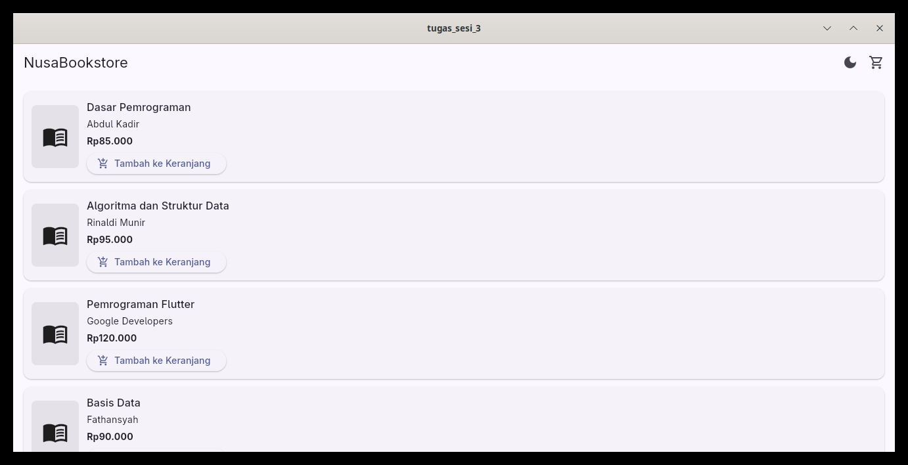
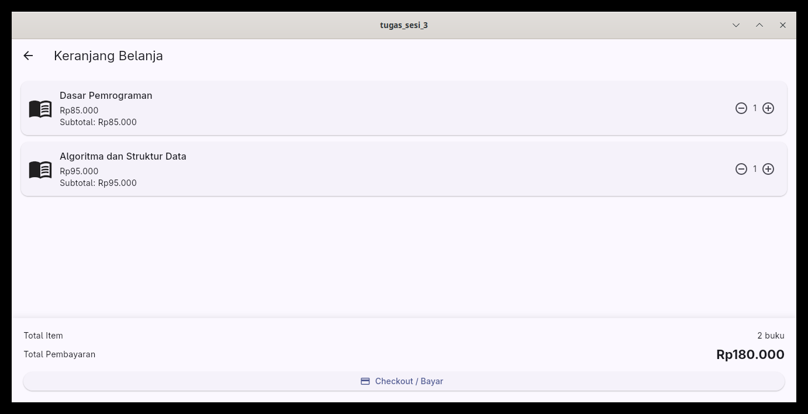
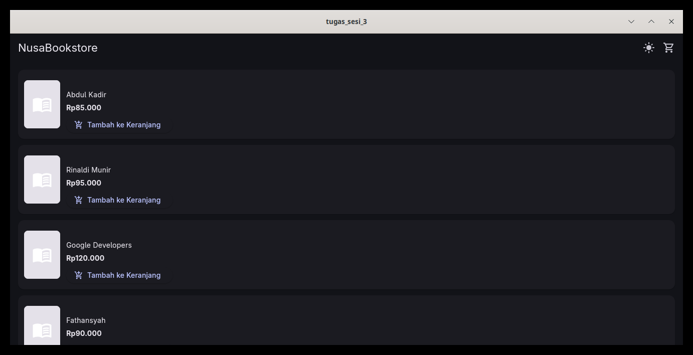
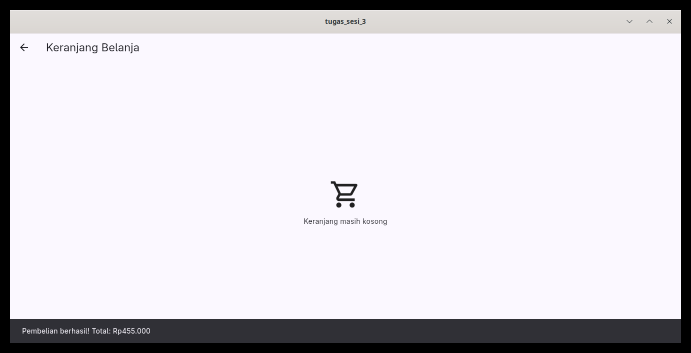

cat > ~/development/kampus/sesi02/product_profile/sesi03/README.md <<'EOF'

# NusaBookstore — Flutter Provider

Aplikasi katalog buku sederhana berbasis Flutter yang menerapkan **State Management menggunakan Provider**. Aplikasi ini dibuat untuk memenuhi tugas mata kuliah Pemrograman Perangkat Mobile Sesi 03.

## 📱 Fitur Aplikasi

- Menampilkan katalog buku dengan informasi judul, penulis, dan harga.
- Menambahkan buku ke keranjang belanja.
- Menampilkan jumlah item pada badge keranjang.
- Menambah dan mengurangi jumlah buku di keranjang.
- Menghapus item dari keranjang melalui tombol pengurangan jumlah.
- Menghitung total item dan total harga secara otomatis.
- Menggunakan format mata uang Rupiah (IDR).
- Mengubah tema aplikasi antara Light Mode dan Dark Mode.
- Menampilkan notifikasi checkout melalui SnackBar.
- Mengosongkan keranjang setelah checkout berhasil.

## 🛠️ Teknologi yang Digunakan

- **Flutter** — framework pengembangan aplikasi.
- **Dart** — bahasa pemrograman.
- **Provider** — state management.
- **ChangeNotifier** — memberi notifikasi perubahan state.
- **Material Design** — komponen antarmuka aplikasi.

## 📂 Struktur Proyek

```text
sesi03/
├── lib/
│   ├── main.dart
│   ├── models/
│   │   └── book.dart
│   ├── providers/
│   │   ├── cart_provider.dart
│   │   └── theme_provider.dart
│   └── screens/
│       ├── catalog_screen.dart
│       └── cart_screen.dart
├── screenshots/
│   ├── katalog.png
│   ├── badge-keranjang.png
│   ├── keranjang.png
│   ├── light-mode.png
│   ├── dark-mode.png
│   └── checkout.png
├── pubspec.yaml
├── pubspec.lock
└── README.md
```

## 🖼️ Tampilan Aplikasi

### 1. Katalog Buku

Menampilkan daftar buku yang tersedia beserta informasi dan tombol untuk menambahkannya ke keranjang.



### 2. Badge Keranjang

Menampilkan jumlah item yang terdapat di keranjang belanja.



### 3. Keranjang Belanja

Menampilkan daftar buku yang dipilih, kontrol jumlah buku, dan total harga belanja.


### 4. Light Mode

Tampilan aplikasi menggunakan tema terang.


### 5. Dark Mode

Tampilan aplikasi menggunakan tema gelap.



### 6. Checkout

Menampilkan notifikasi setelah checkout dan mengosongkan keranjang belanja.



> **Catatan:** Simpan screenshot dengan nama file dan struktur folder yang sama seperti di atas. Jika belum memiliki screenshot, bagian ini bisa dilengkapi nanti.

## 🧠 Implementasi State Management

### Book Model

Model `Book` digunakan untuk merepresentasikan data buku, seperti ID, judul, penulis, harga, dan URL gambar.

### CartProvider

`CartProvider` mengelola state keranjang belanja menggunakan `ChangeNotifier`.

Fungsi utama:
- `addItem()` — menambahkan buku atau meningkatkan jumlahnya.
- `removeItem()` — mengurangi jumlah buku atau menghapus item.
- `clearCart()` — mengosongkan keranjang.
- `totalItems` — menghitung jumlah seluruh buku di keranjang.
- `totalPrice` — menghitung total harga belanja.

Perubahan state diberitahukan melalui `notifyListeners()` agar antarmuka diperbarui secara otomatis.

### ThemeProvider

`ThemeProvider` mengelola tema aplikasi, yaitu Light Mode dan Dark Mode.

Fungsi `toggleTheme()` digunakan untuk mengganti tema. Perubahan tema diterapkan melalui `MaterialApp`.

### MultiProvider

`MultiProvider` digunakan pada root aplikasi untuk menyediakan `CartProvider` dan `ThemeProvider` agar dapat diakses oleh widget yang membutuhkan.

### Consumer dan context

- `Consumer` digunakan untuk membangun ulang bagian antarmuka yang bergantung pada perubahan state.
- `context.watch()` digunakan untuk membaca state sekaligus memantau perubahannya.
- `context.read()` digunakan untuk mengakses provider ketika menjalankan aksi, seperti menambahkan buku atau checkout.

## 🚀 Cara Menjalankan Aplikasi

Pastikan Flutter dan Dart sudah terpasang.

1. Buka terminal pada folder proyek `sesi03`.
2. Jalankan perintah berikut untuk mengunduh dependensi:

   ```bash
   flutter pub get
   ```

3. Jalankan aplikasi:

   ```bash
   flutter run
   ```

4. Untuk memeriksa masalah pada kode:

   ```bash
   flutter analyze
   ```

## ✅ Pengujian Fungsional

Pengujian dilakukan secara manual dengan skenario berikut:

- [x] Katalog menampilkan daftar buku.
- [x] Buku dapat ditambahkan ke keranjang.
- [x] Badge keranjang memperbarui jumlah item.
- [x] Jumlah buku dapat ditambah dan dikurangi.
- [x] Total item dan total harga diperbarui secara otomatis.
- [x] Tema aplikasi dapat diubah antara Light Mode dan Dark Mode.
- [x] Checkout menampilkan notifikasi SnackBar.
- [x] Keranjang menjadi kosong setelah checkout.

## 📚 Tujuan Pembelajaran

Melalui proyek ini, mahasiswa mempelajari penerapan state management menggunakan Provider pada Flutter, termasuk penggunaan `ChangeNotifier`, `MultiProvider`, `Consumer`, `context.watch()`, dan `context.read()` untuk mengelola serta menampilkan perubahan state aplikasi.

## 👨‍🎓 Informasi Tugas

- **Mata Kuliah:** Pemrograman Perangkat Mobile
- **Tugas:** Sesi 03 — State Management menggunakan Provider
- **Nama:** Yasef Hatam
- **NIM:** 20240040010

---

Dibuat sebagai bagian dari tugas praktikum Pemrograman Perangkat Mobile.
